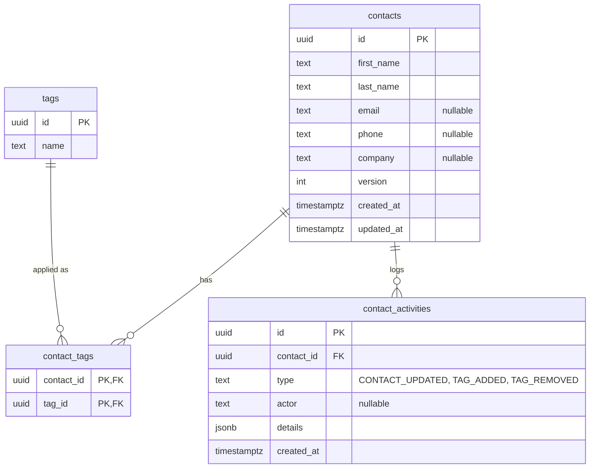

# CRM Contact Workspace

A contact workspace for a CRM: search, filter, sort and page through contacts, edit them safely when several people work at once, tag them (one at a time or in bulk), and see each contact's activity.

**Live:** app https://crm-contact-workspace-hazel.vercel.app · API https://assign-production-de66916a.up.railway.app ([Swagger UI](https://assign-production-de66916a.up.railway.app/docs))

| Folder      | What                                                                                                                                   |
| ----------- | -------------------------------------------------------------------------------------------------------------------------------------- |
| `backend/`  | REST API: Fastify, Kysely, Postgres, migrations, seed, Vitest tests                                                                    |
| `frontend/` | Web app: React 18, Vite, RTK Query, the `@crm/ui` components, Storybook, Playwright tests ([`frontend/README.md`](frontend/README.md)) |
| `docs/`     | The backend and frontend specs this follows                                                                                            |

Contents: [Run it](#run-it) · [Deploy](#deploy) · [Tech stack](#tech-stack) · [API](#api) · [Key decisions](#key-decisions) · [Data model](#data-model) · [Concurrency](#concurrency-approach) · [Pagination](#pagination-and-the-capped-count) · [Tests](#tests) · [Conflict scenario](#try-the-conflict-scenario) · [Known issues](#known-issues) · [Scale notes](#scale-notes) · [AI usage](#ai-usage)

## Run it

Needs Node.js 20+ and Docker.

```bash
cp .env.example .env            # defaults work as-is
docker compose up -d            # Postgres, with the crm and crm_test databases

cd backend && npm install
npm run dev                     # API on http://localhost:3000 (migrates and seeds 20,000 contacts on first start)

cd frontend                     # in a second terminal
cp app/.env.example app/.env    # VITE_API_URL=http://localhost:3000
npm install && npm run dev      # app on http://localhost:5173
```

- Port 5432 taken? Set `POSTGRES_PORT=5433` in `.env` and change the port in both database URLs to match.
- On start the API applies pending migrations and seeds 20,000 contacts **only if the table is empty**, so restarts never touch existing data. `npm run seed -- --count 1000000 --reset` reseeds at any size.
- Main settings (all in `.env.example`): `DATABASE_URL`, `CORS_ORIGIN` (required in production), `TRUST_PROXY_HOPS` (`2` on Railway), `RATE_LIMIT_MAX` (300/min), `STATEMENT_TIMEOUT_MS` (10 s), `ENABLE_DOCS`.
- Backend scripts: `dev`, `build`, `start`, `test`, `migrate`, `seed`, `lint`, `typecheck`. Frontend scripts are in [`frontend/README.md`](frontend/README.md).

## Deploy

**API on Railway** (dashboard): a project with a Postgres service, plus this repo as a service with Root Directory `backend`, build `npm ci && npm run build`, start `npm start` and health check `/health`. Variables:

| Variable           | Value                                                                                            |
| ------------------ | ------------------------------------------------------------------------------------------------ |
| `DATABASE_URL`     | Reference to the Postgres service: `${{Postgres.DATABASE_URL}}`                                  |
| `NODE_ENV`         | `production` (turns on database SSL)                                                             |
| `CORS_ORIGIN`      | The frontend's domain, `https://…vercel.app`, no trailing slash. The API won't start without it. |
| `TRUST_PROXY_HOPS` | `2`, measured on Railway, so rate limits count each visitor separately                           |

Generate a domain under Networking. Migrations and the seed run on start, so nothing is run by hand.

**Frontend on Vercel:** the project's Root Directory is `frontend` (not `frontend/app`: the install needs the whole workspace). [`frontend/vercel.json`](frontend/vercel.json) sets the install, build, `app/dist` output, the single-page-app rewrite and asset caching. The one setting is `VITE_API_URL` (the API's URL), read at build time, so redeploy after changing it. With the GitHub repo connected, a push that changes `frontend/` deploys; other pushes skip the build.

## Tech stack

- **Backend:** Node.js + TypeScript (strict), Fastify 5, Postgres 16 with `pg_trgm`, Kysely (query builder, no ORM), Zod 4 (validation and the OpenAPI document), Swagger UI at `/docs`, Vitest against a real database.
- **Frontend:** React 18 + TypeScript on Vite, Redux Toolkit / RTK Query, React Router 7, TanStack Table, plain CSS modules, Storybook, Playwright. The detail page and edit form load lazily.
- ESLint + Prettier in both.

## API

All endpoints and schemas are at **`/docs`** (Swagger UI), generated from the same Zod schemas the handlers validate with; a test keeps them in step with real responses. No authentication. Optional header `X-Actor: <name>` labels who made a change (a demo "acting as" name; `Anonymous` if missing).

| Endpoint                                                       | Purpose                                                                                                                                 |
| -------------------------------------------------------------- | --------------------------------------------------------------------------------------------------------------------------------------- |
| `GET /contacts`                                                | Search (`q`), filter (`tag`, `company`, `createdFrom`/`createdTo`), sort (`name`/`createdAt`), page (`cursor` or `page`, `limit` ≤ 100) |
| `GET /contacts/:id`                                            | One contact with its tags and `version`                                                                                                 |
| `PATCH /contacts/:id`                                          | Update fields; must send the `version` it started from                                                                                  |
| `GET /contacts/:id/activities`                                 | Recent activity, newest first                                                                                                           |
| `GET /tags`                                                    | Tags by name                                                                                                                            |
| `POST /contacts/:id/tags` · `DELETE /contacts/:id/tags/:tagId` | Add (by id, or by name, created if new) / remove a tag                                                                                  |
| `POST /tags/bulk-assign`                                       | One tag on up to 1,000 contacts; returns `added`, `alreadyTagged`, `notFound`                                                           |
| `GET /health`                                                  | 200 when the database answers                                                                                                           |

Errors share one shape, `{ "error": { "code", "message", "details" } }`: 400 malformed request, 404 not found, 409 `VERSION_CONFLICT` (with the latest contact) or `EMAIL_TAKEN`, 422 field validation, 429 rate limited, 503 busy or query timeout (retryable). 500s carry only a request id.

## Key decisions

- **Optimistic locking with a `version` column.** Two people editing one contact is normal in a CRM; silently overwriting someone is the worst outcome. A stale save gets a 409 with the latest contact so the UI can show what changed.
- **Tag changes don't bump `version`.** Tags are add/remove on a set, so nothing is overwritten, and a tag added in one tab never causes a false conflict for someone editing fields.
- **Keyset pagination with a capped count** instead of `OFFSET`. See [below](#pagination-and-the-capped-count).
- **Trigram indexes for search** make `ILIKE '%text%'` index-assisted without extra infrastructure.
- **Kysely, not an ORM:** row-value keyset comparisons, capped counts and `ON CONFLICT … RETURNING` are easier to get right in near-SQL.
- **Activity is written in the same transaction as the change**, so history never disagrees with the data, and only real changes are logged.
- **The database enforces unique emails** (`lower(email)`, when present), surfaced as a 409, so there's no check-then-insert race.
- **Tests use a real Postgres:** locking, uniqueness and transactions live in the database, so mocking it would test nothing.
- Smaller choices: `tag` filters by id; phones need 7+ digits with `+ ( ) - .` allowed; a page past the end is empty; duplicate ids in a bulk request count once; an unchanged `PATCH` is a 200 with no version bump.

## Data model



Indexes: unique `lower(email)` and `lower(tags.name)`; trigram GIN on names, email and phone; `(created_at, id)` and `(last_name, first_name, id)` for sorting and keyset paging; `company`; `(tag_id, contact_id)`; `(contact_id, created_at DESC)` for activity. Links cascade on delete. Activity stores the tag name, so history still reads right after a rename.

## Concurrency approach

- **Edits:** one transaction locks the contact row, compares versions (mismatch → 409 with the latest contact), writes only changed fields with `WHERE version = $n` and `version + 1`, and logs the activity. Two saves from the same version: exactly one wins (tested by firing both at once).
- **Emails:** normalised, then a unique-index violation becomes 409 `EMAIL_TAKEN` and the whole update rolls back.
- **Tags:** `INSERT … ON CONFLICT DO NOTHING RETURNING`, so the same tag added twice, even at once, gives one link and one activity; creating a tag by name works the same way.
- **Lock order:** every tag write locks the contact before touching links, and bulk assign locks contacts in id order, so single and bulk writes can't deadlock (raced 50 times per case in tests). A deadlock Postgres still reports becomes a retryable 503.
- **Bulk assign:** one transaction, links inserted with `ON CONFLICT`, and all `TAG_ADDED` events in one multi-row insert; repeating the request changes nothing.

## Pagination and the capped count

Next/Previous use **keyset (cursor) pagination** on `(sort key, id)`, so a deep page costs the same as the first and ties never skip or repeat rows. The total is counted with `LIMIT 10001`:

- **≤ 10,000 matches:** an exact total and page numbers ("page 3 of 42"); jumping to a page uses a cheap `OFFSET` on that small set.
- **> 10,000:** `total: "10000+"` and only Prev/Next.

An exact `count(*)` and deep `OFFSET` both scan rows in proportion to the table, on every request; the cap bounds the work at about 10,001 rows however large the table grows. On the 20,000-row seed, list, search and cursor queries take about 3–20 ms.

## Tests

- **Backend** (`cd backend && npm test`, needs Postgres): 319 tests over optimistic locking, email uniqueness, bulk assign (idempotency, rollback, constant query count), pagination with ties, search and filters, validation and error shapes, tag races against bulk assign, CORS, rate limiting behind a proxy, timeouts, startup seeding and the OpenAPI document matching real responses.
- **Frontend** (`cd frontend && npm run test:e2e`, or `test:e2e:headed` to watch): 26 Playwright tests that drive the real app against the real API on a throwaway `crm_e2e` database: URL state, editing and validation, a real two-tab version conflict, single and bulk tags, filter validation, and layout. `npm run check` runs typecheck, lint, format check and both builds.

## Try the conflict scenario

1. Open the same contact in two browser tabs. Pick **Heer** as the acting user in one and **Janardhan** in the other.
2. In Heer's tab change a field and save.
3. In Janardhan's tab change a field and save: the API answers 409, and the dialog shows the latest values next to Janardhan's edits, marks what Heer changed, and says "Last changed by Heer".
4. Choose **Merge both** (when the fields differ), **Reapply my changes** (load Heer's version, keep Janardhan's edits to review) or **Reload latest** (drop them). The activity shows each change with its actor.

Without the UI:

```bash
curl -X PATCH localhost:3000/contacts/<id> -H 'Content-Type: application/json' -H 'X-Actor: Heer' -d '{"version":1,"company":"Heer Co"}'           # 200
curl -X PATCH localhost:3000/contacts/<id> -H 'Content-Type: application/json' -H 'X-Actor: Janardhan' -d '{"version":1,"company":"J Co"}'     # 409
```

## Known issues

- **No authentication or authorization** (not in the brief): every endpoint is public.
- **"Acting as" is a demo label** sent in `X-Actor`; anyone can fake it. In production the actor comes from the logged-in session.
- No endpoints to rename or delete tags, or to delete contacts (not in the brief).
- Searches under 3 characters get little help from the trigram indexes; a search is capped at 5 words and every query at `STATEMENT_TIMEOUT_MS`.
- Phone search is textual: `5550100` doesn't match `+1-555-0100`.
- Page numbers can drift if data changes while paging (cursors don't).
- The rate limiter is in memory, so per instance; several instances would need Redis. It trusts `X-Forwarded-For` up to `TRUST_PROXY_HOPS`, so the API must only be reachable through Railway's edge.
- The database certificate isn't verified unless `DATABASE_CA_CERT` is set; `/docs` is public unless `ENABLE_DOCS=false`.
- Timings at 1,000,000 contacts haven't been measured yet.

## Scale notes

- **Millions of contacts per account:** add `account_id` to every table and index, and partition by account. Keep keyset pagination and the capped count.
- **Millions of updates per day:** keep updates as short single-row transactions; write activity through a transactional outbox to a queue; partition activity by month.
- **Frequent searches and filters:** move search to OpenSearch, fed by change events, keeping trigram indexes until then. Cache tag lists and counts.
- **Many simultaneous users:** stateless API instances behind a load balancer, PgBouncer, read replicas for list and search, optimistic locking for writes.
- **Security:** production would add login, account-level data isolation through `account_id`, and role-based permissions.

## AI usage

- **Tool:** Claude (Claude Code).
- **Used for:** design discussion, writing the specs in `docs/`, scaffolding, and building the backend and frontend task by task with tests, each reviewed and approved by Manish Singh before it was committed.
- **A suggestion that was changed:** Claude proposed cursor-only paging with no total count. Manish changed it to a capped count with page numbers, because the UI needs "page 3 of 42"; that's why the API returns an exact total up to 10,000 and accepts `page` under the cap.
